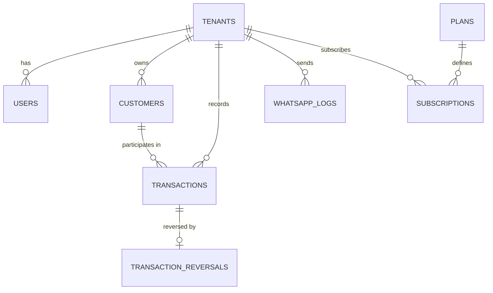

# Database Schema Design — HisabKitab SaaS

All financial numbers are stored in `DECIMAL(15, 2)` to eliminate floating-point rounding errors. Every tenant-owned table contains `tenant_id` with foreign key and composite indexes for high query performance and guaranteed tenant isolation.

---

## 1. Tables Overview & Relationships

---

## 2. Detailed Table Specifications

### 2.1 `tenants` (Shops / Businesses)
Represents an independent registered shopkeeper or retail business.
| Column | Type | Constraints / Details |
|---|---|---|
| `id` | `BIGINT UNSIGNED` | Primary Key, Auto Increment |
| `name` | `VARCHAR(150)` | Shop / Business name (e.g. "Gupta Kirana Store") |
| `slug` | `VARCHAR(150)` | Unique slug for identifier |
| `owner_name` | `VARCHAR(100)` | Primary owner full name |
| `phone` | `VARCHAR(20)` | Unique contact/WhatsApp phone number |
| `email` | `VARCHAR(100)` | Nullable, email address |
| `address` | `TEXT` | Nullable, physical store address |
| `gstin` | `VARCHAR(20)` | Nullable, Indian GSTIN (15 characters) |
| `currency` | `VARCHAR(10)` | Default `'INR'` (₹) |
| `status` | `ENUM('active','inactive','suspended')` | Default `'active'` |
| `logo_path` | `VARCHAR(255)` | Nullable, path to store logo |
| `settings` | `JSON` | Nullable, shop preferences (receipt header, language) |
| `created_at` | `TIMESTAMP` | Created timestamp |
| `updated_at` | `TIMESTAMP` | Updated timestamp |

*Indexes:*
- `UNIQUE (slug)`
- `INDEX (phone)`
- `INDEX (status)`

---

### 2.2 `users` (User Accounts)
Stores login credentials for Super Admins and Shop Owners/Staff.
| Column | Type | Constraints / Details |
|---|---|---|
| `id` | `BIGINT UNSIGNED` | Primary Key, Auto Increment |
| `tenant_id` | `BIGINT UNSIGNED` | Nullable (NULL for Super Admin), FK -> `tenants(id)` ON DELETE CASCADE |
| `name` | `VARCHAR(100)` | User's full name |
| `email` | `VARCHAR(150)` | Unique, email address for login |
| `phone` | `VARCHAR(20)` | Nullable, phone number |
| `role` | `ENUM('super_admin','shop_owner','shop_staff')` | Default `'shop_owner'` |
| `password` | `VARCHAR(255)` | Hashed password (Bcrypt/Argon2) |
| `is_active` | `BOOLEAN` | Default `TRUE` |
| `email_verified_at` | `TIMESTAMP` | Nullable |
| `remember_token` | `VARCHAR(100)` | Nullable |
| `created_at` | `TIMESTAMP` | Created timestamp |
| `updated_at` | `TIMESTAMP` | Updated timestamp |

*Indexes:*
- `UNIQUE (email)`
- `INDEX (tenant_id, role)`
- `INDEX (phone)`

---

### 2.3 `customers` (Shop Borrowers / Customers)
Stores customer profiles who take credit or make payments to a specific shop.
| Column | Type | Constraints / Details |
|---|---|---|
| `id` | `BIGINT UNSIGNED` | Primary Key, Auto Increment |
| `tenant_id` | `BIGINT UNSIGNED` | Not Null, FK -> `tenants(id)` ON DELETE CASCADE |
| `name` | `VARCHAR(150)` | Customer full name |
| `phone` | `VARCHAR(20)` | Customer mobile / WhatsApp number |
| `email` | `VARCHAR(100)` | Nullable, customer email |
| `address` | `TEXT` | Nullable, customer residential/store address |
| `credit_limit` | `DECIMAL(15,2)` | Nullable, maximum credit allowed (0.00 for no limit) |
| `current_balance` | `DECIMAL(15,2)` | Default `0.00`. Positive = Customer owes shop; Negative = Customer advance |
| `status` | `ENUM('active','inactive','blocked')` | Default `'active'` |
| `notes` | `TEXT` | Nullable, private remarks by shopkeeper |
| `last_transaction_at` | `TIMESTAMP` | Nullable, date and time of latest transaction |
| `created_at` | `TIMESTAMP` | Created timestamp |
| `updated_at` | `TIMESTAMP` | Updated timestamp |

*Indexes:*
- `INDEX (tenant_id, phone)`
- `INDEX (tenant_id, name)`
- `INDEX (tenant_id, current_balance)`
- `INDEX (tenant_id, status)`

---

### 2.4 `transactions` (Udhaar & Jama Ledger Entries)
The immutable core financial ledger. Every credit or payment is recorded here.
| Column | Type | Constraints / Details |
|---|---|---|
| `id` | `BIGINT UNSIGNED` | Primary Key, Auto Increment |
| `tenant_id` | `BIGINT UNSIGNED` | Not Null, FK -> `tenants(id)` ON DELETE RESTRICT |
| `customer_id` | `BIGINT UNSIGNED` | Not Null, FK -> `customers(id)` ON DELETE RESTRICT |
| `user_id` | `BIGINT UNSIGNED` | Not Null, FK -> `users(id)` (Staff/Owner who recorded the entry) |
| `transaction_number` | `VARCHAR(50)` | Unique reference (e.g., `TXN-202611-00001`) |
| `type` | `ENUM('credit','payment','reversal')` | `credit` = Udhaar Dena (+), `payment` = Jama Lena (-), `reversal` = Correction |
| `amount` | `DECIMAL(15,2)` | Strictly positive value (> 0.00) |
| `running_balance` | `DECIMAL(15,2)` | Customer balance immediately after this transaction |
| `payment_mode` | `ENUM('cash','upi','bank_transfer','cheque','other')` | Default `'cash'` (relevant for payments) |
| `transaction_date` | `DATE` | Effective date of transaction |
| `description` | `VARCHAR(255)` | Nullable, remarks/items purchased |
| `bill_image_path` | `VARCHAR(255)` | Nullable, uploaded photo of physical slip/bill |
| `is_reversed` | `BOOLEAN` | Default `FALSE`. Flagged when a reversal entry is made |
| `created_at` | `TIMESTAMP` | Created timestamp |
| `updated_at` | `TIMESTAMP` | Updated timestamp |

*Indexes:*
- `UNIQUE (tenant_id, transaction_number)`
- `INDEX (tenant_id, customer_id, transaction_date)`
- `INDEX (tenant_id, type)`
- `INDEX (tenant_id, created_at)`

---

### 2.5 `transaction_reversals` (Audit Trail for Reversals)
Tracks corrections made to any erroneous transaction.
| Column | Type | Constraints / Details |
|---|---|---|
| `id` | `BIGINT UNSIGNED` | Primary Key, Auto Increment |
| `tenant_id` | `BIGINT UNSIGNED` | FK -> `tenants(id)` ON DELETE CASCADE |
| `original_transaction_id` | `BIGINT UNSIGNED` | Unique, FK -> `transactions(id)` |
| `reversal_transaction_id` | `BIGINT UNSIGNED` | Unique, FK -> `transactions(id)` |
| `user_id` | `BIGINT UNSIGNED` | FK -> `users(id)` who initiated reversal |
| `reason` | `VARCHAR(255)` | Mandatory explanation for reversal |
| `created_at` | `TIMESTAMP` | Created timestamp |

---

### 2.6 `plans` & `subscriptions` (SaaS Monetization)
Manages shopkeeper subscriptions and platform access.

#### `plans`:
| Column | Type | Constraints |
|---|---|---|
| `id` | `BIGINT UNSIGNED` | Primary Key |
| `name` | `VARCHAR(50)` | e.g., "Free Starter", "Pro Shopkeeper", "Enterprise" |
| `price` | `DECIMAL(10,2)` | e.g., 0.00, 499.00, 999.00 |
| `duration_days` | `INT` | 30, 365, etc. |
| `customer_limit` | `INT` | Max customers allowed (-1 for unlimited) |
| `features` | `JSON` | Enabled feature flags (WhatsApp reminders, reports, etc.) |
| `is_active` | `BOOLEAN` | Default `TRUE` |

#### `subscriptions`:
| Column | Type | Constraints |
|---|---|---|
| `id` | `BIGINT UNSIGNED` | Primary Key |
| `tenant_id` | `BIGINT UNSIGNED` | FK -> `tenants(id)` |
| `plan_id` | `BIGINT UNSIGNED` | FK -> `plans(id)` |
| `starts_at` | `DATE` | Subscription start |
| `ends_at` | `DATE` | Subscription expiry |
| `status` | `ENUM('active','expired','cancelled','trial')` | Default `'trial'` |
| `payment_details` | `JSON` | Gateway reference, payment mode |

---

### 2.7 `whatsapp_logs` (Audit of Sent Reminders)
| Column | Type | Constraints |
|---|---|---|
| `id` | `BIGINT UNSIGNED` | Primary Key |
| `tenant_id` | `BIGINT UNSIGNED` | FK -> `tenants(id)` |
| `customer_id` | `BIGINT UNSIGNED` | FK -> `customers(id)` |
| `phone` | `VARCHAR(20)` | Recipient phone |
| `message` | `TEXT` | Message text sent |
| `status` | `ENUM('sent','clicked','failed')` | Log status |
| `created_at` | `TIMESTAMP` | Timestamp |

